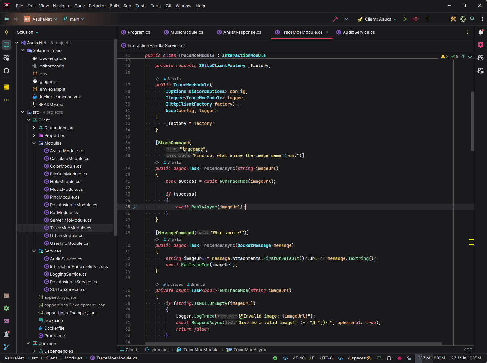
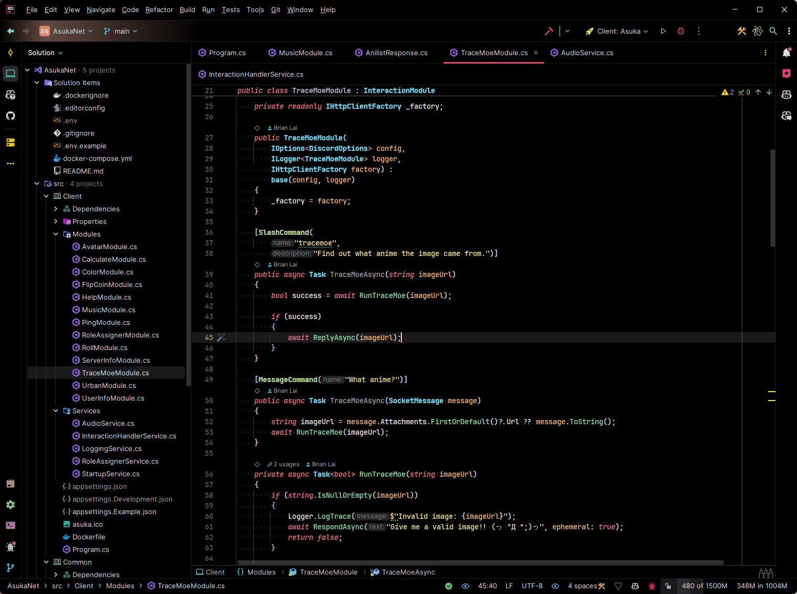
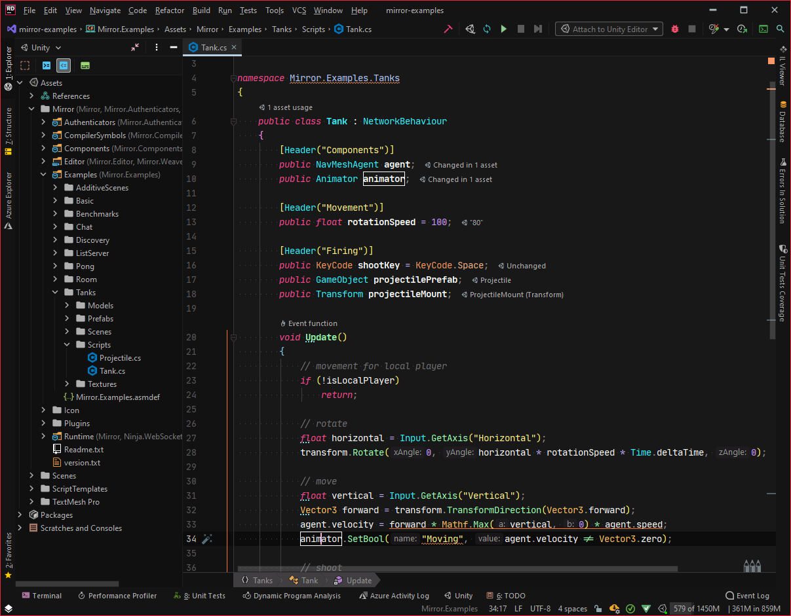
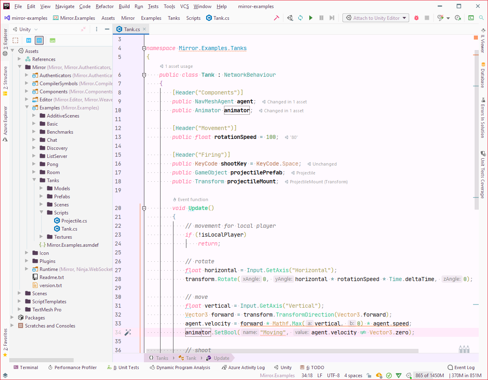

  

  <h1>Lotus Theme</h1>

  
A modern dark theme with colorful syntax highlighting for JetBrains IDEs.

  
  
  
  

## Themes

All themes are built on the Islands UI.

| Theme | Background | Accent |
|---|---|---|
| Lotus Dark Rose | Dark gray | Rose |
| Lotus Dark Sky | Dark gray | Sky |
| Lotus Black Rose | Pure black | Rose |
| Lotus Black Sky | Pure black | Sky |
| Lotus Dark (Classic) | Dark gray | Pink |
| Lotus Light (Classic) | Light | Pink |

The classic themes include editor colors for [Rainbow Brackets](https://plugins.jetbrains.com/plugin/10080-rainbow-brackets).

### Lotus Dark Rose

### Lotus Black Rose

### Lotus Dark (Classic)

### Lotus Light (Classic)

## Installation

Requires a JetBrains IDE version 2025.3 or newer.

1. Open **Settings | Plugins | Marketplace** and search for **Lotus Theme**.
2. Click **Install**.
3. Pick a Lotus theme under **Settings | Appearance & Behavior | Appearance | Theme**.

## Development

The project is a resource-only plugin built with the [IntelliJ Platform Gradle Plugin](https://plugins.jetbrains.com/docs/intellij/tools-intellij-platform-gradle-plugin.html). Gradle provisions the required JDK automatically.

| File | Purpose |
|---|---|
| `src/main/resources/themes/*.theme.json` | UI themes |
| `src/main/resources/colors/*.xml` | Editor color schemes |
| `src/main/resources/META-INF/plugin.xml` | Plugin descriptor and Marketplace description |
| `gradle.properties` | Plugin version, oldest supported IDE build, IDE version to build against |
| `CHANGELOG.md` | Release notes, rendered into the plugin's change notes |

| Command | Description |
|---|---|
| `./gradlew runIde` | Launch a sandbox IDE with the plugin installed |
| `./gradlew check` | Validate theme JSON and color scheme XML (`verifyThemes`) |
| `./gradlew verifyPlugin` | Run the IntelliJ Plugin Verifier against supported IDEs |
| `./gradlew buildPlugin` | Build the plugin zip into `build/distributions` |

## Releasing

1. Add notes under `## Unreleased` in `CHANGELOG.md` and set `version` in `gradle.properties`.
2. Push to `main`. The Build workflow verifies the plugin and refreshes a draft release named after the version.
3. Publish the draft under **Releases**. The Release workflow publishes to JetBrains Marketplace, attaches the plugin zip, and opens a pull request that moves the notes under the released version.
4. Merge that pull request.
5. Bump `version` in `gradle.properties` for the next release.

One-time setup:

- Add a `PUBLISH_TOKEN` repository secret with a [JetBrains Marketplace token](https://plugins.jetbrains.com/author/me/tokens).
- Enable **Settings | Actions | General | Allow GitHub Actions to create and approve pull requests**.
- Optional: add `CERTIFICATE_CHAIN`, `PRIVATE_KEY`, and `PRIVATE_KEY_PASSWORD` secrets to [sign the plugin](https://plugins.jetbrains.com/docs/intellij/plugin-signing.html). Without them, the unsigned plugin is published.

## License

[MIT](LICENSE)
